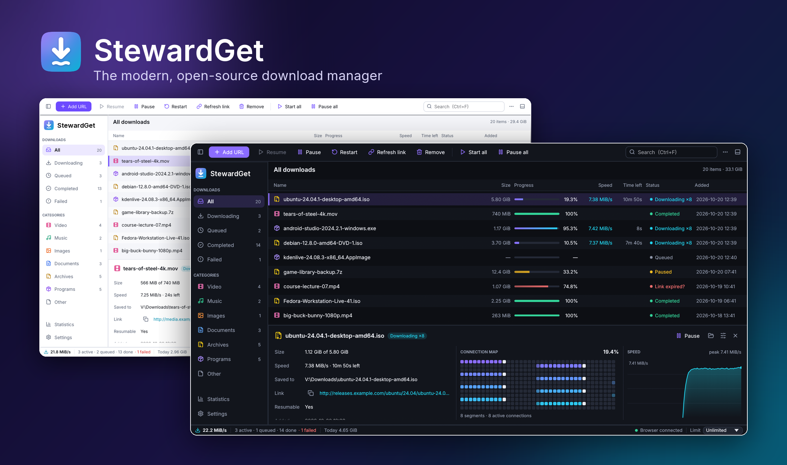
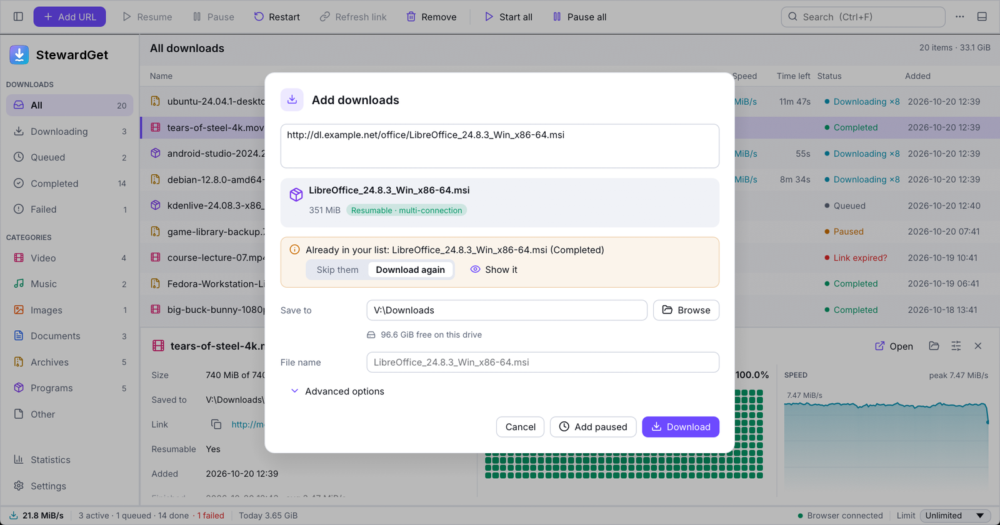
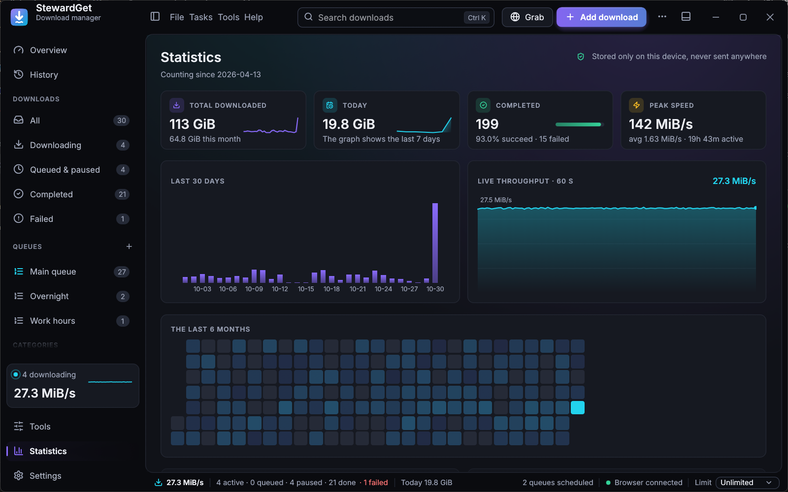
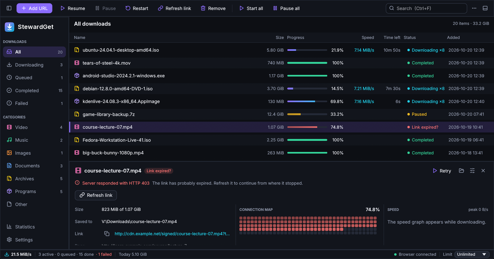
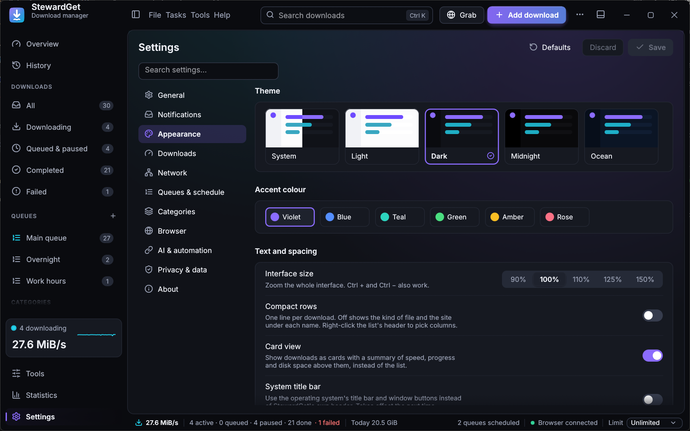

<p align="center">
  
</p>

<h1 align="center">StewardGet</h1>

<p align="center">
  <b>A fast, modern, open-source download manager — think IDM, rebuilt for today.</b><br>
  Desktop app · terminal UI · CLI · browser extension · Windows, macOS &amp; Linux · zero telemetry<br>
  <sub>Formerly Velox: <a href="CHANGELOG.md#070---2026-10-23">upgrading keeps your downloads, settings and extension</a>.</sub>
</p>

<p align="center">
  <a href="https://github.com/anand34577/stewardget/actions/workflows/ci.yml"></a>
  <a href="https://github.com/anand34577/stewardget/releases/latest"></a>
  <a href="#license"></a>
</p>

<p align="center">
  <a href="#install"><b>Download</b></a> ·
  <a href="#features">Features</a> ·
  <a href="https://github.com/anand34577/stewardget/wiki">Guide</a> ·
  <a href="docs/ARCHITECTURE.md">How it works</a>
</p>

<p align="center">
  
</p>

## Why StewardGet?

Internet Download Manager set the standard for segmented downloading, but it is
Windows-only, closed source, nags for licences, has a dated UI, assembles files
in a slow extra step, and its "refresh download address" flow is awkward.
StewardGet keeps everything that made IDM great and fixes the rest.

| | IDM | **StewardGet** |
|---|---|---|
| Platforms | Windows | **Windows, Linux, macOS, any terminal** |
| Source / price | Closed, paid, serial nags | **Open source (MIT/Apache-2.0), free** |
| Segmented downloads | Static split + some re-splitting | **Dynamic work-stealing: idle connections take half of the busiest range until the last byte** |
| Finishing large files | Separate "assembling" step | **None — every connection writes straight into the final file (sparse pre-allocation)** |
| Servers that limit connections | Errors / stalls | **Adaptive: failing extra connections back off, healthy ones take over their ranges** |
| Expired links | Manual "refresh address" dialog | **Refresh link: StewardGet opens the page, catches your next click in the browser and resumes the same file** |
| Crash safety | Partial | **Progress checkpointed every 3 seconds; partial data is never discarded without asking** |
| Server file changed | Starts over silently | **Stops and asks: resume anyway, refresh the link, or start over** |
| Before downloading | Name and size only | **Link check: real name, size, resume support, free disk space, duplicate warning** |
| Integrity | — | **MD5 / SHA-1 / SHA-256 / SHA-512 verification** |
| Statistics | Minimal | **Live graphs, per-download speed history, 30-day history, sources and categories** |
| Automation | Limited | **CLI, scriptable local API, terminal dashboard** |
| Look | Windows 98 era | **Five themes (System, Light, Dark, Midnight, Ocean), six accents, Inter font, interface zoom** |
| Privacy | Phones home | **No telemetry, no analytics; an update check exists but is off until you turn it on** |

## Screenshots

| | |
|---|---|
|  |  |
| **Add** — the link is checked before downloading: real name, size, resume support, free space, duplicates. | **Statistics** — 30-day history, live throughput, categories and sources. Stored only on your device. |
|  |  |
| **Refresh link** — an expired link never costs you the 75 % already downloaded. | **Appearance** — five themes, six accents, interface zoom. |

## Features

**Engine**
- Multi-connection segmented downloads (1–32 per file) with dynamic splitting and work stealing.
- Pause / resume / restart, resume across restarts and crashes, re-add a link to continue its partial data.
- HTTP/1.1 by default so each segment gets its own TCP connection (HTTP/2 would multiplex them into one).
- Exponential back-off with jitter, stall detection, per-connection retries, adaptive connection count;
  servers that say `Retry-After` (429/503) are obeyed.
- **Automatic retry of failed downloads** (network or server trouble) with growing pauses.
- Global, per-queue and per-download speed limits (token bucket), adjustable live, plus a **different
  limit for set hours** (e.g. slower during work hours).
- **Queues**: as many as you like, each with its own order, limit, speed cap and **schedule** (start/pause
  times, weekdays); times missed while the computer slept are caught up.
- Smart file names (`Content-Disposition`, RFC 5987, URL, MIME type), safe names on every OS, no overwrites.
- **Your own categories** (name + extensions) next to the built-in ones, a folder per category, checksum
  verification, original modification time preserved.
- When a file already exists: keep both or replace; optionally **run a program after each download**
  (virus scan, unpack) without a shell.
- Proxy (HTTP/HTTPS/SOCKS5), custom headers, cookies, referrer and user agent.
- Free-space check before downloading; "disk full" is reported clearly and can be retried.

**Your data is safe**
- Progress is checkpointed every 3 seconds, data first and then the record, so a crash or power cut loses
  at most a few seconds of work.
- Partial data is never thrown away silently: if the server's file changes or no longer supports resuming,
  StewardGet stops and offers *Resume anyway*, *Refresh link* or *Start over*.
- Removing a download keeps its partial data unless you choose to delete it, and adding the link again continues it.
- The download list has rolling backups; a damaged list is set aside and restored automatically.

**Desktop app**
- IDM-style layout: category sidebar, action toolbar, dense sortable table, details pane with a live
  **connection map** and speed graph, status bar with total speed, browser status and limit picker.
- **New-download window** for browser downloads, like IDM's: name, size, resume support, folder, queue,
  then *Download* or *Later*. Lists of links get checkboxes and type filters.
- **Add dialog with link check** (real file name, size, resume support), free-space hint, duplicate detection,
  batch patterns (`img[001-120].jpg`), recent folders, "Download later".
- Drag downloads onto a queue in the sidebar to move them; start and stop each queue on its own.
- **Progress window** for each download, like IDM's, also while StewardGet is in the tray: transfer rate, time left, resume support, each connection's progress, the parts, its own speed limit, Pause. It turns into *Download complete* when the file is done.
  Opens by itself for a download started on its own; double-click any download to open it.
- **Properties** (F2): rename or move files on disk, change link, connections, limits, headers, checksum.
- Clear problem messages with the right fix: refresh link, resume anyway, start over, move to another drive.
- Optional *Download complete* window for every finished download, "when all downloads finish" quit / sleep / shut down (with a countdown).
- Hash tool (MD5, SHA-1, SHA-256, SHA-512) for finished files; import and export link lists.
- Multi-select (Ctrl/Shift), context menus, keyboard shortcuts, double-click to open, clipboard monitoring.
- Five themes, six accent colours, interface zoom, Inter typeface and Lucide icons; fully responsive layout.
- First-run setup, optional start with your computer (minimised), keep running in the background when
  the window closes, and a single window: opening StewardGet again brings the running one forward.
- **Tray icon** (Windows) / menu-bar icon (macOS): minimise hides StewardGet there, with speed and quick
  actions; **system notifications** when downloads finish or fail; the window remembers its size and
  position; settings backup and restore.
- **Site grabber**: find the files linked from a page (optionally a few levels deep, honouring `robots.txt`).
- Warns about programs disguised as documents (`invoice.pdf.exe`).

**AI assistants (MCP)**
- Optional MCP server (**Settings › AI & automation**, off by default): an assistant can add, list,
  pause, resume, restart and remove downloads and set the speed limit. Local only, token protected, files
  stay below your download folder, no settings changes and no programs run. `stewardget mcp --config` prints
  the client settings.

**Browser integration** (Chrome, Edge, Brave, Opera, Vivaldi, Firefox)
- Guided setup in the app with a live "connected" status; the extension updates with the app.
- Takes over browser downloads, passing cookies, referrer and user agent, so logged-in downloads work.
- "Download with StewardGet" on any link, image, video or audio, and "Download all links with StewardGet" for a page.
- **Video and audio on a page**: the extension lists the media a page played (files and HLS streams);
  StewardGet saves a stream as one `.ts` or `.mp4`, decrypting AES-128 streams. Downloads that answer a form
  (POST) stay in the browser, since they can't be repeated.
- Size, file-type and per-site filters, **Alt+click** to keep a download in the browser; falls back to
  the browser when StewardGet isn't running.

**Terminal**
- `stewardget` — an interactive dashboard with the same features (works over SSH).
- `stewardget get <url>…` — wget-style downloads with live multi-bar progress; Ctrl+C and re-run to resume.
- `stewardget add <url>…` — hand URLs to the running app, to any queue; `stewardget queues` lists the queues.

## Install

| System | One-click download | Notes |
|---|---|---|
| **Windows 10/11** (x64 and ARM64) | [**StewardGet-Setup.exe**](https://github.com/anand34577/stewardget/releases/latest/download/StewardGet-Setup.exe) | No administrator rights needed. [Portable zip](https://github.com/anand34577/stewardget/releases/latest) also available. |
| **macOS 11+** (Apple silicon and Intel) | [**StewardGet-macos.dmg**](https://github.com/anand34577/stewardget/releases/latest/download/StewardGet-macos.dmg) | Open it and drag StewardGet to Applications. |
| **Debian, Ubuntu, Mint, Pop!_OS** | [x64 .deb](https://github.com/anand34577/stewardget/releases/latest/download/stewardget-linux-x64.deb) · [ARM64 .deb](https://github.com/anand34577/stewardget/releases/latest/download/stewardget-linux-arm64.deb) | `sudo apt install ./stewardget-linux-x64.deb` |
| **Fedora, openSUSE, RHEL** | [x64 .rpm](https://github.com/anand34577/stewardget/releases/latest/download/stewardget-linux-x64.rpm) · [ARM64 .rpm](https://github.com/anand34577/stewardget/releases/latest/download/stewardget-linux-arm64.rpm) | `sudo dnf install ./stewardget-linux-x64.rpm` |
| **Any Linux** | install script below | Installs into `~/.local`, no root needed. |

Or install from a terminal. The scripts pick the right build, verify its checksum and open StewardGet:

```sh
# Linux and macOS
curl -fsSL https://github.com/anand34577/stewardget/releases/latest/download/install.sh | sh
```

```powershell
# Windows (PowerShell)
irm https://github.com/anand34577/stewardget/releases/latest/download/install.ps1 | iex
```

On first start, StewardGet asks where to save downloads, offers to start with your computer and walks you
through connecting your browser. The builds are not code-signed yet, so Windows and macOS show a
one-time warning for the downloaded installer; the
[installation guide](https://github.com/anand34577/stewardget/wiki/Installation) shows what to click.
`SHA256SUMS.txt` on the release page lists every file's checksum.

Uninstall from Windows Settings › Apps, by moving StewardGet to the Bin on macOS, with
`sudo apt remove stewardget` / `sudo dnf remove stewardget`, or with the install script's `--uninstall` option.
Your downloads and settings are kept unless you choose otherwise.

### Browser extension

Open **Settings › Browser** in StewardGet. Pick your browser (Chrome, Edge, Brave, Opera, Vivaldi or Firefox)
and follow the three steps shown; the status turns green as soon as the extension connects. The app
keeps the extension folder up to date when StewardGet updates. From a terminal, `stewardget extension` prints
the same steps. Details: [Browser extension guide](https://github.com/anand34577/stewardget/wiki/Browser-Extension).

### Build from source

With a recent Rust toolchain (1.95+):

```sh
git clone https://github.com/anand34577/stewardget
cd stewardget
cargo build --release
```

Binaries land in `target/release/` (`stewardget-gui` and `stewardget`).
Linux needs the usual windowing headers, e.g. on Debian/Ubuntu:
`sudo apt install libxkbcommon-dev libwayland-dev libxcb-render0-dev libxcb-shape0-dev libxcb-xfixes0-dev libgl1-mesa-dev`.
The scripts that build the installers and packages are in [`packaging/`](packaging).

## Using it

### Refreshing an expired link

Signed links (cloud drives, file hosts, CDNs) often expire. When a download stops with
*HTTP 403/404/410* or *“the remote file changed”*:

1. Select it and click **Refresh link** (or press <kbd>w</kbd> in the terminal UI).
2. StewardGet opens the page the download came from and waits.
3. Click the download button on that page again. The extension hands the new link to StewardGet,
   which recognises the same file (by size or name), swaps the link and **continues from where it stopped**.

You can also paste a new link directly (<kbd>u</kbd> in the terminal UI).

### Keyboard shortcuts (desktop)

| Keys | Action |
|---|---|
| <kbd>Ctrl</kbd>+<kbd>N</kbd> | Add URLs |
| <kbd>Ctrl</kbd>+<kbd>V</kbd> | Paste links to add |
| <kbd>Ctrl</kbd>+<kbd>O</kbd> | Import links from a text file |
| <kbd>Ctrl</kbd>+<kbd>F</kbd> | Search |
| <kbd>Space</kbd> | Pause / resume selection |
| <kbd>F2</kbd> | Properties |
| <kbd>Delete</kbd> / <kbd>Shift</kbd>+<kbd>Delete</kbd> | Remove / remove and delete files |
| <kbd>Enter</kbd> | Open completed file |
| <kbd>Ctrl</kbd>+<kbd>A</kbd> | Select all |
| <kbd>Ctrl</kbd>+<kbd>,</kbd> | Settings |
| <kbd>Ctrl</kbd>+<kbd>Q</kbd> | Quit StewardGet |
| <kbd>Ctrl</kbd>+<kbd>+</kbd> / <kbd>Ctrl</kbd>+<kbd>-</kbd> | Zoom |

Press <kbd>?</kbd> in the terminal UI for its shortcuts.

### CLI

```sh
stewardget get https://example.com/big.iso                        # download here
stewardget get -c 16 -l 5M -d ~/Downloads URL1 URL2               # 16 connections, 5 MiB/s cap
stewardget get --checksum sha256:9f86d0… URL                       # verify integrity
stewardget get -H "Cookie: session=abc" URL                        # custom headers
stewardget get -i links.txt                                        # read URLs from a file
stewardget add URL                                                 # queue in the running app
stewardget add --queue Night --paused URL                          # add to a queue, to start on its schedule
stewardget queues                                                  # list the queues
stewardget list [--json] | stewardget stats | stewardget config
stewardget pause all | stewardget resume 4 | stewardget remove 4 --delete-file
stewardget limit 2M                                                # cap the running app's speed
stewardget grab https://example.com/files/ -d 1 -e zip,iso --add   # find files on a page, add them
stewardget mcp --config                                            # settings for an MCP client
stewardget completions powershell                                  # shell completion script
stewardget extension --open                                        # set up the browser extension
```

## Privacy

StewardGet has **no telemetry, analytics, crash reporting or update checks**. The only network traffic is
the downloads you start. The browser API listens on `127.0.0.1` only, rejects requests from web pages
and can require a token. Settings, the download list and statistics are plain JSON files in your
data directory (`stewardget config` shows where). For a portable install, put an empty file named `portable`
next to the executables (the Windows portable zip has one) or set `STEWARDGET_DATA_DIR`.

## Project layout

```
crates/stewardget-core   download engine (library)
crates/stewardget-cli    `stewardget` — CLI and terminal UI (ratatui)
crates/stewardget-gui    `stewardget-gui` — desktop app (egui)
extension/          browser extension (Manifest V3), bundled into the apps
packaging/          installers, Linux packages, macOS app bundle, install scripts
docs/               architecture notes
```

See [docs/ARCHITECTURE.md](docs/ARCHITECTURE.md) for how the engine works.

## Contributing

Contributions are welcome — see [CONTRIBUTING.md](CONTRIBUTING.md).

## License

Dual-licensed under [MIT](LICENSE-MIT) or [Apache-2.0](LICENSE-APACHE), at your option.

The bundled [Inter](https://rsms.me/inter/) typeface is under the SIL Open Font License 1.1 and the
[Lucide](https://lucide.dev) icons under the ISC License; see `crates/stewardget-gui/assets/`.
